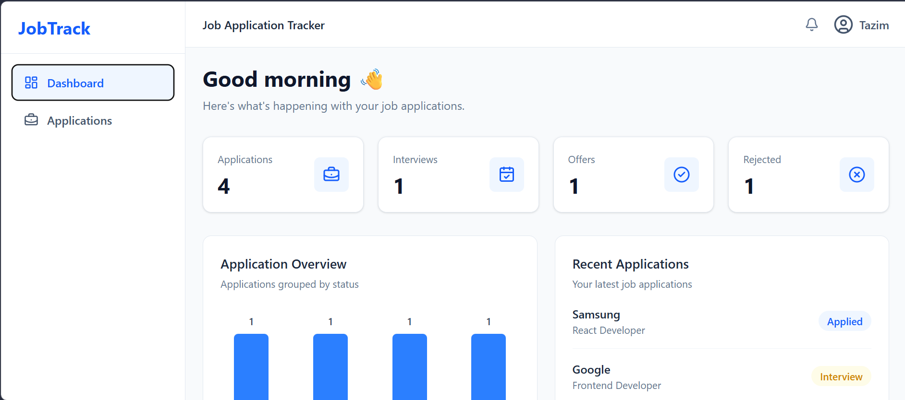
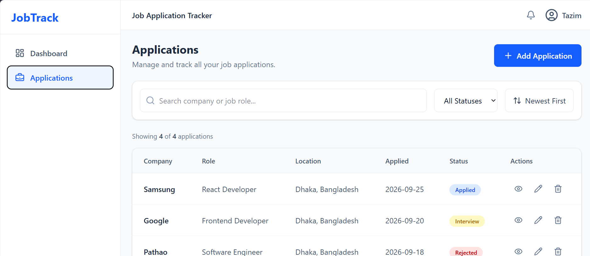
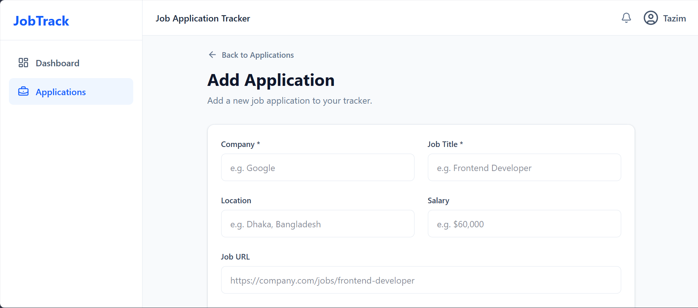

# JobTrack — Job Application Tracker

A modern, responsive job application tracking dashboard built with **React, Vite, Tailwind CSS, React Router, Context API, and React Hook Form**.

JobTrack helps users organize job applications, monitor application status, search and filter opportunities, and manage application details from a single dashboard.

---

## 🚀 Live Demo

🔗 **Live Demo:** `https://taziim.github.io/Jobtrack/applications`

🔗 **GitHub:** `YOUR_GITHUB_REPOSITORY_URL`

---

## 📸 Screenshots

> Add screenshots of your application here after deployment.

### Dashboard



### Applications



### Add Application



---

## ✨ Features

### Dashboard

- Overview of total applications
- Interview count
- Offer count
- Rejected application count
- Recent application activity
- Responsive dashboard layout

### Application Management

- Add new job applications
- View application details
- Edit existing applications
- Delete applications
- Track application status
- Store salary and location information
- Add notes to applications
- Save job posting URLs

### Search & Filtering

- Search by company name
- Search by job role
- Filter by application status
- Sort applications by application date
- Clear filters
- Display filtered result count

### User Experience

- Responsive design
- Loading states
- Error states
- Toast notifications
- Confirmation before deleting applications
- Empty-state UI
- Reusable components
- Client-side data persistence

---

## 🛠️ Tech Stack

| Technology | Purpose |
|---|---|
| React | UI development |
| Vite | Development environment and build tool |
| Tailwind CSS | Styling and responsive design |
| React Router | Client-side routing |
| Context API | Global application state |
| React Hook Form | Form handling and validation |
| Lucide React | UI icons |
| React Hot Toast | Notifications |
| LocalStorage | Client-side persistence |

---

## 📁 Project Structure

```text
jobtrack/
│
├── src/
│   ├── components/
│   │   ├── common/
│   │   │   ├── ErrorMessage.jsx
│   │   │   └── Loading.jsx
│   │   │
│   │   └── layout/
│   │       ├── DashboardLayout.jsx
│   │       ├── Navbar.jsx
│   │       └── Sidebar.jsx
│   │
│   ├── context/
│   │   └── ApplicationContext.jsx
│   │
│   ├── pages/
│   │   ├── Dashboard.jsx
│   │   ├── Applications.jsx
│   │   ├── AddApplication.jsx
│   │   ├── ApplicationDetails.jsx
│   │   └── EditApplication.jsx
│   │
│   ├── services/
│   │   └── applicationService.js
│   │
│   ├── App.jsx
│   ├── main.jsx
│   └── index.css
│
├── public/
├── package.json
├── vite.config.js
└── README.md
```

---

## ⚙️ Installation

### 1. Clone the repository

```bash
git clone YOUR_GITHUB_REPOSITORY_URL
```

### 2. Enter the project directory

```bash
cd jobtrack
```

### 3. Install dependencies

```bash
npm install
```

### 4. Start the development server

```bash
npm run dev
```

The application will be available at:

```text
http://localhost:5173
```

---

## 🏗️ Production Build

Create an optimized production build:

```bash
npm run build
```

Preview the production build locally:

```bash
npm run preview
```

---

## 🧠 Application Architecture

The application follows a simple layered architecture:

```text
                    ┌──────────────────┐
                    │      Pages       │
                    │ Dashboard        │
                    │ Applications     │
                    │ Add / Edit       │
                    └────────┬─────────┘
                             │
                             ▼
                    ┌──────────────────┐
                    │  Context API     │
                    │ Application      │
                    │ State Management │
                    └────────┬─────────┘
                             │
                             ▼
                    ┌──────────────────┐
                    │ Service Layer    │
                    │ applicationService│
                    └────────┬─────────┘
                             │
                             ▼
                    ┌──────────────────┐
                    │   LocalStorage   │
                    └──────────────────┘
```

The service layer is separated from the UI so the application can later replace LocalStorage with a REST API without requiring major changes to the components.

---

## 🧩 Routing

JobTrack uses React Router for client-side navigation.

| Route | Page |
|---|---|
| `/` | Dashboard |
| `/applications` | Applications |
| `/applications/new` | Add Application |
| `/applications/:id` | Application Details |
| `/applications/:id/edit` | Edit Application |

---

## 📊 Application Statuses

Applications can have one of four statuses:

```text
Applied
Interview
Offer
Rejected
```

These statuses are used throughout the dashboard, filtering system, and application details.

---

## 💾 Data Persistence

Currently, JobTrack stores application data in the browser using:

```text
localStorage
```

The application uses a dedicated service layer:

```text
src/services/applicationService.js
```

This makes it easier to migrate to a backend API in the future.

A future architecture could look like:

```text
React
  ↓
Context API
  ↓
Service Layer
  ↓
REST API
  ↓
Node.js / Express
  ↓
PostgreSQL
```

---

## 🔮 Future Improvements

Possible future versions of JobTrack could include:

- [ ] User authentication
- [ ] Node.js/Express backend
- [ ] PostgreSQL database
- [ ] REST API
- [ ] Analytics and charts
- [ ] Application deadlines
- [ ] Interview scheduling
- [ ] Email reminders
- [ ] Resume management
- [ ] Dark mode
- [ ] Pagination
- [ ] Advanced filtering
- [ ] Mobile navigation
- [ ] Cloud data synchronization
- [ ] Automated job import
- [ ] Deployment with CI/CD

---

## 📱 Responsive Design

JobTrack is designed to work across:

- Desktop
- Laptop
- Tablet
- Mobile devices

The interface uses Tailwind CSS responsive utilities to adapt the layout to different screen sizes.

---

## 🧪 Testing the Application

After starting the development server, test the following workflow:

```text
Dashboard
   ↓
Applications
   ↓
Add Application
   ↓
View Application
   ↓
Edit Application
   ↓
Update Application
   ↓
Delete Application
```

Also test:

- Search
- Status filtering
- Sorting
- Empty search results
- Browser refresh
- LocalStorage persistence
- Responsive layout

---

## 🎯 Learning Objectives

This project demonstrates practical frontend development concepts including:

- Component-based architecture
- React hooks
- Context API
- State management
- Derived state
- Client-side routing
- Form validation
- CRUD operations
- Search and filtering
- Data persistence
- Loading and error handling
- Responsive UI development
- Service-layer architecture

---

## 👨‍💻 Author

**Tariqul Islam**

Frontend Developer

### Skills

- React
- JavaScript
- Tailwind CSS
- HTML
- CSS
- React Router
- REST API
- Git & GitHub

---

## 📄 License

This project is created for learning, portfolio, and demonstration purposes.

---

## ⭐ If You Like This Project

If you find JobTrack useful or interesting, consider giving the repository a ⭐ on GitHub.